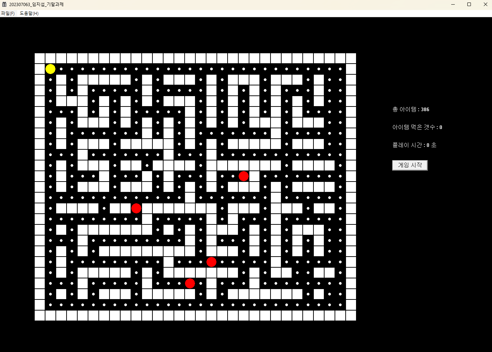
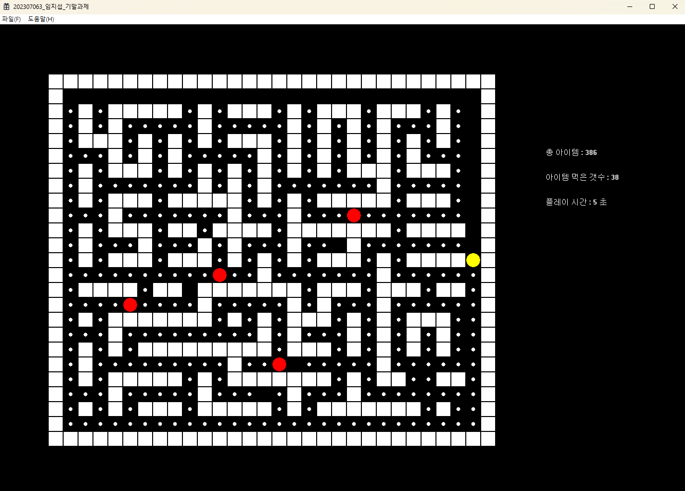
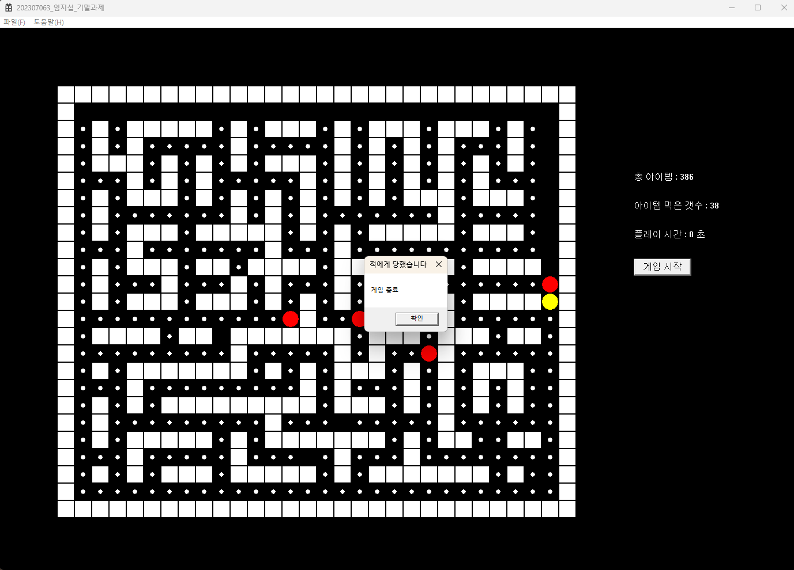
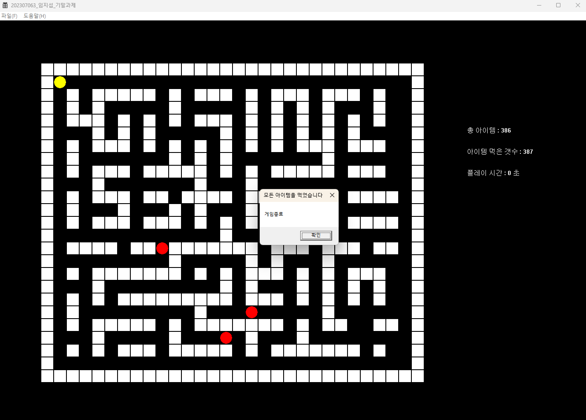

# VC_final_ex

VC++ 기말과제 — Win32 API로 만든 팩맨 스타일 미로 게임

## 개요

랜덤으로 생성된 미로에서 플레이어(노란 원)를 움직여 모든 아이템(작은 원)을 먹으면 승리하는 게임입니다.
적(빨간 원)은 BFS 알고리즘으로 플레이어를 추적하며, 적과 부딪히면 게임이 종료됩니다.

## 실행 화면

| 시작 화면 | 플레이 화면 |
| --- | --- |
|  |  |
| **적에게 잡혔을 때** | **모든 아이템을 먹었을 때** |
|  |  |

## 주요 기능

- **랜덤 미로 생성**: 30 x 25 크기의 맵에 테두리 벽과 랜덤 방향으로 연장되는 내부 벽 생성
- **플레이어 이동**: 방향키로 한 칸씩 이동, 벽 충돌 처리
- **적 AI**: BFS(너비 우선 탐색)로 플레이어까지의 최단 경로를 계산해 추적, 적끼리 겹치지 않도록 대체 경로 탐색
- **아이템 수집**: 먹은 아이템 개수 / 총 아이템 개수 표시, 모두 먹으면 게임 종료
- **플레이 시간**: 게임 시작 후 경과 시간(초) 표시
- **일시정지**: `P` 키로 일시정지 / 재개
- **게임 리셋**: 게임 종료 시 맵과 상태를 초기화하고 시작 버튼 다시 표시
- **더블 버퍼링**: 메모리 DC에 그린 뒤 `BitBlt`로 복사해 깜빡임 방지

## 조작법

| 키 | 동작 |
| --- | --- |
| `게임 시작` 버튼 | 게임 시작 |
| `←` `↑` `→` `↓` | 플레이어 이동 |
| `P` | 일시정지 / 재개 |

## 구현 내용

### 1. 맵 데이터 구조

맵은 `int map_area[30][25]` 2차원 배열로 관리하며, 각 칸의 상태를 `enum`으로 구분합니다.

| 값 | 의미 |
| --- | --- |
| `space` (0) | 빈 칸 (아이템을 먹은 자리) |
| `wall` (1) | 벽 |
| `item` (2) | 아이템 |
| `start` (3) | 플레이어 시작 위치 |
| `enemy` (4) | 적 시작 위치 |

화면에서는 한 칸을 30px로 그리고, 맵 전체를 (100, 100)부터 그립니다.
그래서 배열 좌표와 화면 좌표를 아래 식으로 서로 바꿉니다.

```cpp
// 배열 → 화면
left = 100 + i * 30;
top  = 100 + j * 30;

// 화면 → 배열
i = (left - 100) / 30;
j = (top  - 100) / 30;
```

### 2. 랜덤 미로 생성 — `Map_Area::Setmap()`

1. 모든 칸을 `item`으로 채웁니다.
2. 맵의 가장자리를 `wall`로 둘러쌉니다.
3. 내부의 짝수 좌표 `(2, 2), (2, 4), ...`마다 기둥 벽을 세우고, `rand() % 4`로 상하좌우 중 한 방향을 골라 벽을 한 칸 더 늘립니다.
4. 랜덤한 칸 10개를 다시 `item`으로 바꿔 벽을 뚫고 추가 통로를 만듭니다.
5. `(1, 1)`을 플레이어 시작 위치로 정합니다.
6. 벽이 아닌 칸 중 랜덤한 4곳에 적을 배치합니다.
7. 남은 `item` 칸 수를 세어 총 아이템 개수(`f_item`)로 저장합니다.

### 3. 맵 그리기와 아이템 수집 — `Map_Area::Getmap()`

- 배열을 돌며 `wall`은 30px 사각형(`Rectangle`), `item`은 칸 가운데에 10px 원(`Ellipse`)으로 그립니다.
- 아이템을 그릴 때 `IntersectRect`로 플레이어 영역과 겹치는지 확인합니다. 겹치면 그 칸을 `space`로 바꾸고 먹은 개수(`g_item`)를 1 늘립니다.
- 화면 오른쪽에 총 아이템 수, 먹은 아이템 수, 플레이 시간을 `wsprintf` + `TextOut`으로 출력합니다.
- `g_item == f_item`이면 타이머를 멈추고 "모든 아이템을 먹었습니다" 메시지를 띄운 뒤 리셋 명령을 보냅니다.

### 4. 플레이어 이동 — `OBject::setPlayer()`

- `WM_KEYDOWN`에서 방향키 입력을 받아 플레이어의 현재 배열 좌표를 구합니다.
- 이동할 칸이 벽(`1`)이면 움직이지 않고, 아니면 플레이어 `RECT`를 30px 옮깁니다.
- 이동 후 모든 적과 `IntersectRect`로 충돌을 검사해, 부딪히면 게임을 끝냅니다.

### 5. 적 AI (BFS 추적) — `OBject::setEnemy()`, `OBject::bfs()`

적은 타이머(270ms)마다 한 칸씩 플레이어를 향해 움직입니다.

**BFS로 다음 칸 찾기**
1. 적의 현재 위치를 큐에 넣고 상하좌우로 넓혀 가며 탐색합니다. 맵 범위 밖, 이미 방문한 칸, 벽은 건너뜁니다.
2. 새 칸을 방문할 때마다 `parent[nx][ny]`에 어디서 왔는지 기록합니다.
3. 플레이어 위치에 도착하면 `parent`를 따라 거꾸로 올라가, **시작 위치 바로 다음 칸**을 찾아 반환합니다.
4. 플레이어에게 가는 길이 없으면 제자리를 반환합니다.

BFS는 가까운 칸부터 탐색하므로, 이렇게 찾은 경로가 항상 최단 경로입니다.

**적끼리 겹치지 않게 하기**
- `std::set<std::pair<int,int>> occupied_positions`에 적들이 차지한 칸을 저장합니다.
- BFS가 정해 준 칸에 이미 다른 적이 있으면 상하좌우의 다른 칸을 찾아 이동합니다. 갈 곳이 없으면 제자리에 머무릅니다.
- 이동이 끝나면 플레이어와 충돌했는지 확인해, 부딪혔으면 "적에게 당했습니다" 메시지를 띄우고 게임을 끝냅니다.

### 6. 게임 진행 제어 — `WndProc`

| 메시지 | 처리 내용 |
| --- | --- |
| `WM_CREATE` | 맵·객체 생성(`std::unique_ptr`), 미로 생성, 맵 데이터를 `OBject`에 복사, 백버퍼 DC와 `게임 시작` 버튼 생성 |
| `WM_COMMAND` (1) | 시작 버튼 클릭: `gameStarted = true`, 타이머 1(적 이동 270ms)과 타이머 2(플레이 시간 1초) 시작, 버튼 숨김 |
| `WM_COMMAND` (2) | 게임 종료 시 호출: `resetGame()`으로 초기화하고 버튼을 다시 표시 |
| `WM_TIMER` | 타이머 1이면 적 이동, 타이머 2면 플레이 시간 1초 증가, 이후 `InvalidateRect`로 다시 그리기 |
| `WM_KEYDOWN` | 방향키로 플레이어 이동, `P` 키로 타이머를 끄고 켜서 일시정지/재개 |

### 7. 게임 리셋 — `Map_Area::resetGame()`

- 적 목록을 비우고 플레이어를 시작 위치로 되돌리며, 플레이 시간을 0으로 만듭니다.
- `setAreaCopy()`로 맵을 다시 복사하면서 `enemy`(4) 칸에서 적을 다시 만듭니다.
- 빈 칸(`space`)을 모두 `item`으로 되돌리고 아이템 개수를 다시 셉니다. 미로 모양은 그대로 유지됩니다.

### 8. 더블 버퍼링

- `WM_CREATE`에서 `CreateCompatibleDC`로 메모리 DC(백버퍼)를 만듭니다.
- `WM_SIZE`에서 창 크기에 맞춰 `CreateCompatibleBitmap`으로 비트맵을 새로 만들어 연결합니다.
- `WM_PAINT`에서는 백버퍼를 검은색으로 칠하고 맵, 플레이어, 적을 그린 뒤 `BitBlt`로 화면에 한 번에 복사합니다.
- `InvalidateRect(hWnd, NULL, FALSE)`로 배경 지우기를 생략해 깜빡임을 없앴습니다.

## 프로젝트 구조

```
VC_final_ex/
├── VC_final_ex.sln
└── VC_final_ex/
    ├── VC_final_ex.cpp   # WinMain, WndProc (타이머, 입력, 그리기, 버튼 처리)
    ├── map.h / map.cpp   # Map_Area: 미로 생성, 맵·UI 그리기, 아이템 처리, 게임 리셋
    └── object.h / object.cpp  # OBject: 플레이어·적 그리기 및 이동, BFS 추적
```

## 빌드 및 실행

1. Visual Studio에서 `VC_final_ex.sln`을 엽니다. (C++ 데스크톱 개발 워크로드 필요)
2. 구성을 `Debug` 또는 `Release`, 플랫폼을 `x64`로 선택합니다.
3. `F5`(디버그 시작) 또는 `Ctrl + F5`(디버그하지 않고 시작)로 실행합니다.

## 라이선스

[LICENSE](LICENSE) 파일을 참고하세요.
